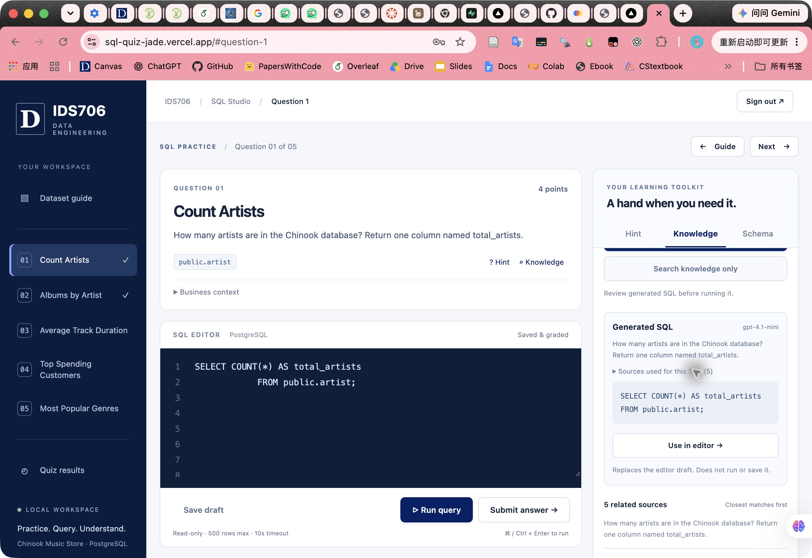
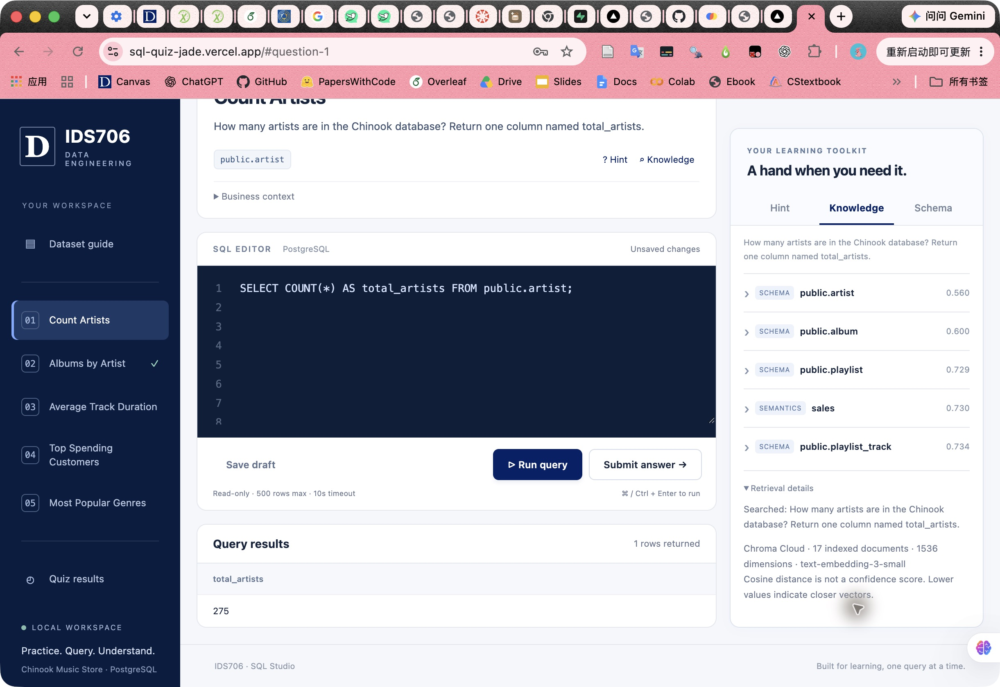

# Application screenshots

## Week 8: deployed RAG application

Captured from the signed-in public application on October 21, 2026 after configuring the production Chroma/OpenAI secrets and redeploying.

### Natural-language question and generated SQL

### Manual execution and cloud retrieval evidence

The generated artist-count query returned 275. The retrieval inspector identifies Chroma Cloud, 17 documents and 1536-dimensional OpenAI embeddings. Execution was explicitly triggered; this is not evidence of automatic SQL validation extra credit.

## Original Week 7 screenshots

The following preserved screenshots predate the live-reference/RAG update and document the original quiz and audit workflow.

## Week 7 application screenshot 1

## Week 7 application screenshot 2

## Week 7 application screenshot 3

## Week 7 application screenshot 4

## Week 7 audit logging screenshot

